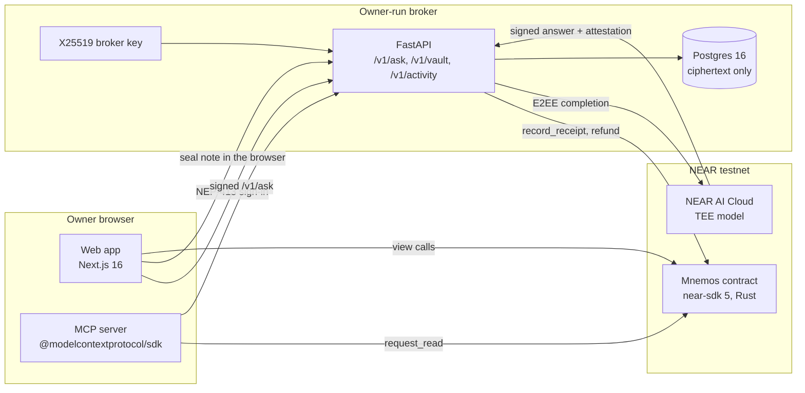

# Mnemos

User-owned AI memory with metered, revocable access on NEAR.

An owner stores encrypted notes in scopes. An MCP agent can ask grounded
questions only through an on-chain grant that is scoped, priced, capped and
revocable. Answers run inside a NEAR AI Cloud TEE with E2EE and verified
attestation; the agent gets an answer, never the notes. Every read leaves a
hash-only receipt on chain and pays the owner.

## Try it in five steps

From a clean clone, with Docker, Node 22+, pnpm, Python 3.12+ and `uv`
installed:

1. **Configure.** `cp .env.example .env`, then fill in `NEARAI_API_KEY`, the
   four NEAR account ids and `BROKER_X25519_PRIVATE_KEY`. The deployed
   testnet ids are already in `.env.example` as examples:
   `make install`.
2. **Start the stack.** `docker compose up -d --build`. Postgres, the broker
   and the web app come up healthy; the broker runs its Alembic migrations on
   start.
3. **Open the ledger.** `open http://localhost:3000`. The Setup screen shows
   the contract, the network and the broker fingerprint compared with the
   value registered on chain.
4. **Store a note.** On the Vault screen, unlock with a passphrase and add a
   note in the `travel` scope. The browser seals it with
   `@mnemos/crypto` before it is sent; the broker stores ciphertext only.
   See: the item id, its content hash and a row in the vault table.
5. **Run the demo.** `make demo` grants the demo agent one scope, asks a
   question through the MCP server, prints the verified attestation and the
   receipt hash, runs the red-team attack set, revokes the grant and shows
   the same read being denied with `E_GRANT_REVOKED`.

## Architecture



The order matters: the contract charges the agent and creates the read
request before the broker decrypts anything. A request that is not served is
refunded.

## NEAR technology used

| Piece | What it is |
| --- | --- |
| `near-sdk` 5.30 | The Rust contract: grants, caps, expiry, credit, receipts, refunds. |
| `near-workspaces` 0.24 | Sandbox tests for the contract, including every negative path. |
| `near-api-js` 7.4 | Wallet transactions and view calls in the MCP server and the web app. |
| `@hot-labs/near-connect` 0.12 | The wallet connection recommended by the NEAR documentation. |
| NEAR AI Cloud `nearai-inference-sdk` 0.3 | Chat completions with `e2ee=True` and model attestation verification. |
| FastNEAR testnet RPC | `https://test.rpc.fastnear.com` for view calls and transactions. |

## Trust model in three sentences

The broker is owner-run and is the scope enforcer: it decrypts only the scope
a grant names, and the owner is the root of trust for that boundary. The
model host cannot read the prompt or the answer, because the completion runs
with end-to-end encryption inside a TEE whose attestation the broker verifies
before it uses the answer. What the system does **not** stop is inference
leakage through repeated narrow questions, which is why every grant has a
price and a daily cap, and why the red-team screen reports residual risk
instead of claiming a guarantee.

The long version is in [`docs/TRUST_MODEL.md`](docs/TRUST_MODEL.md); the
threat model is in [`docs/SECURITY.md`](docs/SECURITY.md).

## Repository

| Path | What it holds |
| --- | --- |
| `contracts/mnemos` | The Rust contract, its unit tests and the sandbox suite. |
| `apps/broker` | The FastAPI broker, its Alembic migrations and the pytest suite. |
| `apps/mcp` | The MCP server, the `mnemos-agent` CLI and the client examples. |
| `apps/web` | The Next.js app: landing, setup, vault, grants, activity, earnings, red-team. |
| `packages/crypto` | The TypeScript envelope encryption, mirrored by the Python package. |
| `packages/crypto-vectors` | Shared vectors that both languages must reproduce byte for byte. |
| `docs` | Architecture, trust model, security, decisions, verification, design review. |

## Commands

```bash
make install     # Node, Python and Rust dependencies
make check       # static checks and unit tests for every language
make test-e2e    # contract sandbox, broker integration tests, Playwright
make demo        # the scripted end-to-end demo against testnet
make up          # docker compose up for postgres, broker and web
```

## Testnet deployment

| | |
| --- | --- |
| Contract | `mnemos-contract-76badc8e.testnet` |
| Owner | `mnemos-owner-76badc8e.testnet` |
| Agent | `mnemos-agent-76badc8e.testnet` |
| Broker | `mnemos-broker-76badc8e.testnet` |
| Broker key fingerprint | `f15d7141fd619dd65cc7fac29cb5a3a11d642aaa47f6a00f757bfedf9e6eb0a4` |

The evidence for every claim above is in
[`docs/VERIFICATION.md`](docs/VERIFICATION.md).

## Built during the window

All code in this repository was written during the NEAR HACKATHON 2026
window, between 11 November and 14 November 2026.

**Sibling project.** This project is independent of *Agent Bureau*. The two
projects share no code, no infrastructure and no team; they are separate
entries in the hackathon.

## Licence

MIT. See [`LICENSE`](LICENSE).
