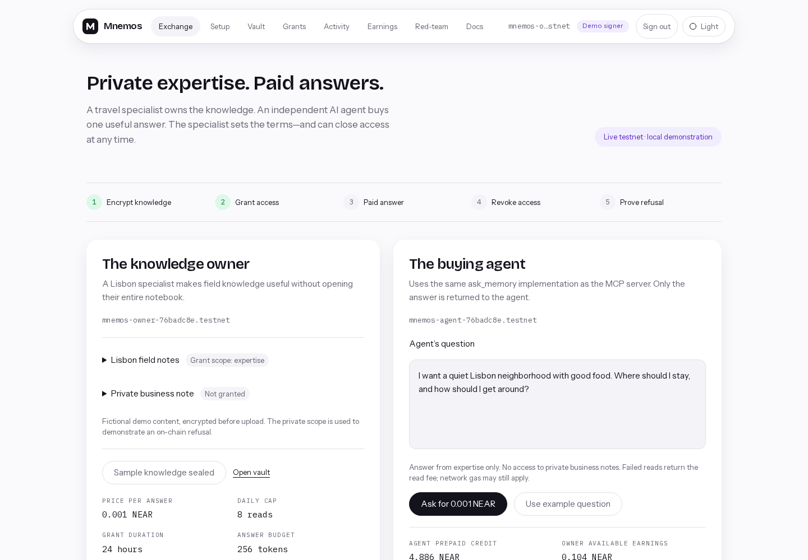
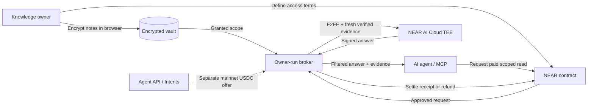

<p align="center">
  
</p>

<h1 align="center">Mnemos</h1>
<p align="center"><strong>Private expertise. Paid answers. Access you control.</strong></p>
<p align="center">Built on NEAR · Verified private AI · Policy-bound agent commerce</p>
<p align="center">
  <a href="#see-it-work">Demo</a> ·
  <a href="docs/NEAR_INTEGRATION.md">NEAR integration</a> ·
  <a href="docs/ARCHITECTURE.md">Architecture</a> ·
  <a href="docs/VERIFICATION.md">Evidence</a> ·
  <a href="docs/ROADMAP.md">Roadmap</a>
</p>

---

## Your knowledge can be useful without becoming someone else's notebook

AI agents need context that public models do not have: an expert's field notes,
a team's internal knowledge, or a person's preferences. Sharing an entire vault
gives away too much. A generic paywall gives the owner too little control.

**Mnemos makes an answer the unit of exchange.** An expert encrypts their notes,
authorizes a named agent to use a particular category, and sets the price and
access terms. The agent buys a grounded answer. The expert receives payment and
an auditable receipt—and can revoke future access.

> **Example:** A Lisbon specialist offers travel expertise while keeping private
> business notes outside the grant. An agent pays to ask where a visitor should
> stay. It receives a verified answer; an attempt to read the private category is
> refused. After revocation, the same travel question is refused too.

The demonstration uses clearly labeled fictional notes and real infrastructure.

[](docs/DEMO.md)

## See it work

On the configured laptop:

```bash
make demo-ready
```

Open **[localhost:3000/exchange](http://localhost:3000/exchange)**.

1. Start the local owner session and encrypt the sample knowledge.
2. Grant expertise access: **0.001 testnet NEAR**, eight reads per UTC day,
   a 24-hour expiry, and a 256-token answer budget.
3. Ask a question. Inspect the answer, TEE evidence, and settlement transaction.
4. Try the private scope, revoke access, and repeat the question.

The laptop controls distinct owner and agent accounts. The guided flow uses the
same `ask_memory` implementation as the MCP server. No browser wallet is needed
for this local rehearsal; the regular wallet workflows remain available.

**Starting from a fresh checkout?** Follow [SETUP.md](docs/SETUP.md) to supply your
own credentials and testnet accounts. Private keys and API credentials are not
included in the repository.

[Demo walkthrough and narration →](docs/DEMO.md)

## Why NEAR is essential

| Product requirement | Integration in the critical path |
| --- | --- |
| The expert controls access and gets paid | A Rust NEAR contract checks grants, scope, price, read caps, expiry and prepaid credit; escrows the fee; and settles receipts or refunds. |
| Sensitive context needs private inference | NEAR AI Cloud receives an E2EE request only after fresh attestation verification. The broker requires a model-serving TEE signature and one matching verified model report. |
| The buying agent needs bounded authority | A separate Agent API offer uses owner-signed wallet policies, scoped runtime grants, destination rules and transfer limits. The local testnet reader uses a restricted function-call key. |
| A submitted payment is not yet a completed purchase | The Intents path waits for an exact matching successful execution before decrypting expertise. Accepted operation IDs and refund transitions are persisted for recovery. |

This is a layered integration: **NEAR enforces the exchange, NEAR AI protects
inference, and Agent API governs the buyer's wallet.**

[Source-level integration guide, endpoints and verification commands →](docs/NEAR_INTEGRATION.md)

## What you can verify today

| Capability | Delivery status |
| --- | --- |
| Browser-encrypted vault and cross-language envelope format | Implemented; shared TypeScript/Python vectors |
| Scoped grants, paid reads, receipts, refunds and revocation | Real NEAR testnet path |
| Fresh TEE attestation, E2EE and response-signature verification | Real NEAR AI Cloud calls; invalid-nonce rejection checked live |
| Agent API wallet creation and owner-signed policies/grants | Provisioned through the official service |
| Destination, per-transfer limit and revoked-grant refusals | Checked with real Agent API execution requests |
| Mainnet USDC expertise purchases and recovery | Implemented; success, refund and crash/retry behavior covered by HTTP-fixture/real-Postgres tests; wallets intentionally unfunded |
| USD-budget refusal and funded 1Click settlement | Next activation milestone; not claimed as live-verified |

The mainnet wallet appears separately in Exchange and says **Funding needed**.
Its new-purchase button is disabled while unfunded. Testnet balances are never
presented as mainnet revenue.

[Verification record →](docs/VERIFICATION.md) · [Machine-readable live checks →](docs/JUDGING_EVIDENCE.json)

## The architecture



The broker checks authorization and payment before decrypting the permitted
scope. It verifies inference, applies the output policy, and records settlement
before releasing a successful answer.

The USDC offer is a distinct payment rail with its own policy and receipts;
it does not debit testnet credit or pretend to create a testnet receipt.

[Detailed flows, storage and recovery →](docs/ARCHITECTURE.md)

## Designed for ownership, with explicit boundaries

The owner chooses and operates the broker. Its key can decrypt notes wrapped to
it, so **the broker remains trusted**. The TEE protects the model-hosting boundary;
it does not turn the broker into an enclave.

A contract receipt proves settlement recorded by the registered broker, while
model attestation and signatures provide separate inference evidence. Authorized
answers can reveal facts. The lexical output filter reduces long verbatim
reproduction; it is not a complete disclosure-prevention system. Revocation stops
future access and cannot retract answers already delivered.

These boundaries drive the next stage: attested broker execution, cumulative
query policies, independent payment-proof verification and mainnet activation.

[Security and trust →](docs/SECURITY.md) · [Future scope →](docs/ROADMAP.md)

## Built for existing agents

The MCP server exposes three tools:

| Tool | Purpose |
| --- | --- |
| `ask_memory` | Buy a scoped answer and receive its verification and settlement evidence. |
| `list_grants` | Inspect available scopes, price, expiry and remaining reads. |
| `check_credit` | Read the agent's prepaid testnet credit. |

It supports stdio and Streamable HTTP. Connection examples are included for
[Claude Code](examples/claude-code.mcp.json) and [Cursor](examples/cursor.mcp.json).
This is Mnemos' own MCP server.

## Run and verify

```bash
make install          # Install the pinned project dependencies
make check            # Static checks and unit tests across all packages
make test-e2e         # Contract sandbox, real Postgres and browser workflows
make doctor           # Diagnose the configured laptop deployment
make judging-check    # Fresh AI, nonce rejection, keys and Agent API refusals
make record-demo      # Record/assert the actual browser demonstration
```

Live inference consumes NEAR AI Cloud credits. `make test-e2e` includes live
red-team browser checks and can take several minutes. The slow sandbox
UTC-day rollover test remains explicitly opt-in.

For the additional Agent wallet:

```bash
make agent-api-setup   # Provision or renew service credentials and signed policies
make agent-api-check   # Exercise the real policy refusals
```

Mainnet funding is an explicit separate action. It is not required for the
working testnet demonstration and is currently left off by choice.

## Documentation

| Guide | What it answers |
| --- | --- |
| [Setup](docs/SETUP.md) | How to reproduce the project with your own credentials. |
| [Demo](docs/DEMO.md) | What to show, say and test during the demonstration. |
| [NEAR integration](docs/NEAR_INTEGRATION.md) | Where each NEAR technology is used and how to verify it. |
| [Architecture](docs/ARCHITECTURE.md) | How requests, encryption, settlement and recovery work. |
| [Security](docs/SECURITY.md) | What is enforced and where trust remains. |
| [Roadmap](docs/ROADMAP.md) | How the prototype develops into a broader knowledge economy. |
| [Verification](docs/VERIFICATION.md) | Test results, live evidence and reproducible checks. |
| [Submission](docs/SUBMISSION.md) | Prepared hackathon description, demo post and submission checklist. |

## Repository map

```text
apps/web/              Next.js dashboard, guided Exchange and evidence views
apps/broker/           FastAPI broker, encrypted storage and payment coordination
apps/mcp/              Agent tools, CLI and MCP transports
contracts/mnemos/      Rust NEAR contract and sandbox tests
packages/crypto/       Browser/Node envelope encryption
packages/crypto-vectors/ Shared interoperability vectors
scripts/               Setup, deployment, diagnostics and live verification
```

**Hackathon tracks:** Privacy & Private AI, AI Security & Defense, Agent Economy.

**Sibling disclosure:** Mnemos is independent of *Agent Bureau*. They share no
code, infrastructure or team and are separate entries.

**License:** [MIT](LICENSE).
