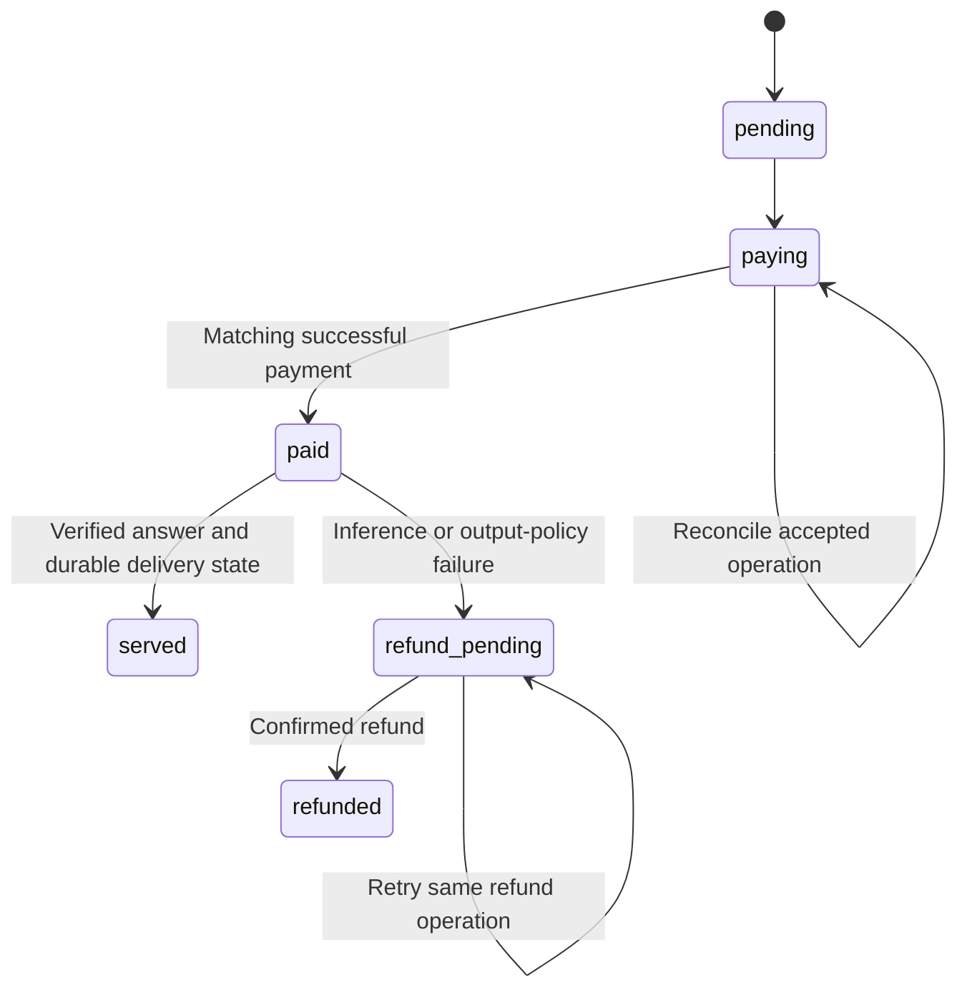

# Architecture

## One answer, three independent responsibilities

Mnemos separates knowledge authorization, private inference and payment. This
keeps the trust model understandable and allows each boundary to improve
without replacing the rest of the product.

| Responsibility | Enforcement point |
| --- | --- |
| Which expert knowledge may be used | The expert's grant and the owner-run broker's scope selection |
| Whether a testnet read is authorized and funded | The NEAR contract |
| Whether a model response has accepted private-inference evidence | NEAR AI Cloud SDK verification plus Mnemos' response policy |
| What the mainnet buying wallet may spend | Owner-signed Agent API policy and runtime grant |
| Whether a purchase can release an answer | Broker settlement checks and persistent request state |

## Components

| Component | Stack | Role |
| --- | --- | --- |
| Owner application | Next.js, TypeScript, React | Encrypt notes, manage grants, inspect evidence and run the guided Exchange. |
| Mnemos contract | Rust, `near-sdk` | Hold testnet credit, authorize reads, escrow fees, settle receipts and handle refunds. |
| Broker | Python, FastAPI | Authenticate requests, select/decrypt scope, rank context, verify inference and coordinate settlement. |
| Storage | PostgreSQL, SQLAlchemy, Alembic | Store encrypted envelopes, request state and evidence. |
| Agent integration | TypeScript MCP server and CLI | Expose `ask_memory`, `list_grants` and `check_credit`. |
| Crypto package | TypeScript and Python | Share one envelope format, checked against interoperability vectors. |
| Agent API adapter | Server-side HTTP client | Submit policy-bound Intents transfers and match finalized execution status. |

## Testnet paid-read sequence

```mermaid
sequenceDiagram
    actor Expert
    participant Agent as Agent / MCP
    participant Chain as NEAR contract
    participant Broker as Owner-run broker
    participant Model as NEAR AI Cloud TEE

    Expert->>Chain: Grant scope, price, cap and expiry
    Agent->>Chain: request_read(owner, scope, question commitment)
    Chain-->>Agent: Approved request; fee escrowed
    Agent->>Broker: Signed request, question and nonce
    Broker->>Chain: Check request, grant and agent key
    Note over Broker: Claim request once; decrypt permitted owner/scope
    Broker->>Model: Fresh attestation verification, then E2EE completion
    Model-->>Broker: Response and model signature
    Note over Broker: Verify signature/evidence; apply output policy
    Broker->>Chain: Settle receipt or refund failed read
    Chain-->>Broker: Transaction result
    Broker-->>Agent: Answer and evidence, or a refusal
```

The contract checks the named grant, scope, expiry, read cap and credit before
creating an approved request. The fee is reserved before decryption. Only the
registered broker may settle it. The receipt commits to application evidence;
it contains neither the notes nor the answer text.

The broker validates the signed question commitment and key ownership, claims
the request through a unique database record, and checks the grant again before
loading scope data. Requests that are not served have refund/expiry recovery.
Read-fee refunds do not imply that network gas is free.

## A separate mainnet offer

The Agent API path is an additional **0.01 USDC expertise offer**. It is not a
conversion of testnet credit into mainnet value.

1. The configured knowledge owner authorizes the offer through their session.
2. The server accepts `expertise` only and binds a purchase ID to its question
   and immutable payment terms.
3. The Agent API checks the buyer's signed policy and runtime grant.
4. The broker waits for a matching successful Intents transfer: buyer, asset,
   amount, recipient, reference and settled intent identifier must agree.
5. Only then does the same real inference/filtering implementation process the
   permitted knowledge.
6. An answer is released after its delivery state is persisted. Failed inference
   or withheld output enters the refund path.

**Current operating state:** mainnet wallets are intentionally unfunded. Real
policy refusals are verified; successful mainnet purchase/refund behavior is
covered by HTTP-fixture/real-Postgres tests and remains a live-activation milestone.

## Recovery is part of the purchase



A dedicated PostgreSQL transaction-level advisory lock serializes one purchase
ID. Separate commits persist the accepted operation identifier, paid state and
refund intent before the next external side effect. A crash after an external
refund cannot move that read back into inference.

Retries keep the same external idempotency key. Once an operation is accepted,
status recovery uses its stored identifier without requiring a fresh spending
grant. Owner-authorized refund/reconciliation by ID does not require the original
question or an old session cookie. Unfinished reads are listed separately from
recent completed receipts.

Answer plaintext is not saved for replay after a completed delivery. A reload
can recover bookkeeping and unresolved money state, but not reconstruct an
already delivered answer from storage.

## Encryption and data lifetime

Each note is encrypted with AES-256-GCM under a random per-item data-encryption
key. That key has two independent wraps:

- **Owner wrap:** PBKDF2-HMAC-SHA256 with 600,000 iterations and a per-owner salt,
  followed by AES-256-GCM.
- **Broker wrap:** ephemeral X25519 exchange, HKDF-SHA256 and AES-256-GCM.

Authenticated metadata binds the envelope to its intended identity and context.
The same byte layout is checked in the TypeScript and Python implementations
using [shared vectors](../packages/crypto-vectors/vectors.json).

| Stored data | Purpose |
| --- | --- |
| `vault_items` | Ciphertext, nonces, wrapped data keys, scope and content commitment. |
| `owner_accounts` | Owner identifier and KDF salt. |
| `read_requests` | Testnet request state, settlement/refund identifiers and inference evidence. |
| `commerce_reads` | Immutable USDC terms, accepted operation IDs, payment/refund state and answer commitment. |
| `auth_challenges` | Expiring, single-use sign-in challenges. |
| `audit_events` | Operational identifiers and error codes. |

Account, scope, timing and payment metadata is not a confidential transcript.
Vault note plaintext, question text and answer text are not persisted as database
columns. The broker does process selected plaintext in memory. Existing retention
jobs cover expired challenges, audit events, deleted notes and testnet request
records; a broader commerce retention/export policy belongs to production rollout.
The contract's receipt ring is bounded, not an unlimited archival service.

## API map

| API | Caller | Purpose |
| --- | --- | --- |
| `/v1/auth/challenge`, `/v1/auth/verify` | Owner | NEP-413 sign-in and session creation. |
| `/v1/broker/pubkey` | Public | Discover the encryption key and registration fingerprint. |
| `/v1/vault/items`, `/v1/vault/salt` | Owner | Manage encrypted notes and owner salt. |
| `/v1/ask` | Signed agent | Execute the approved testnet read. |
| `/v1/activity`, `/v1/activity/stream` | Owner | Inspect the merged ledger and live updates. |
| `/v1/commerce/status` | Configured owner | Inspect the Agent wallet, policy and unresolved purchases. |
| `/v1/commerce/ask` | Configured owner | Authorize the fixed expertise offer under the buyer wallet policy. |
| `/v1/commerce/refund` | Configured owner | Reconcile or refund an unresolved purchase by ID. |
| `/v1/redteam/run` | Owner | Run the real-model attack set without an on-chain read fee. |
| `/healthz`, `/readyz` | Public | Liveness and dependency readiness. |

The broker's generated OpenAPI documentation is available locally at
[localhost:8000/docs](http://localhost:8000/docs).

## Deployment model

Docker Compose runs the web application, broker and PostgreSQL on loopback.
The broker applies Alembic migrations before serving. The NEAR contract is
separately deployed to testnet. The guarded local signing routes require
explicit demo flags, a local origin and the configured owner's authenticated
session.

This is an owner-operated laptop deployment. Public hosting, multi-owner
onboarding and stronger broker isolation are deliberate next milestones, not
implied properties of the Compose setup.

[NEAR source map →](NEAR_INTEGRATION.md) · [Security →](SECURITY.md) · [Roadmap →](ROADMAP.md)
