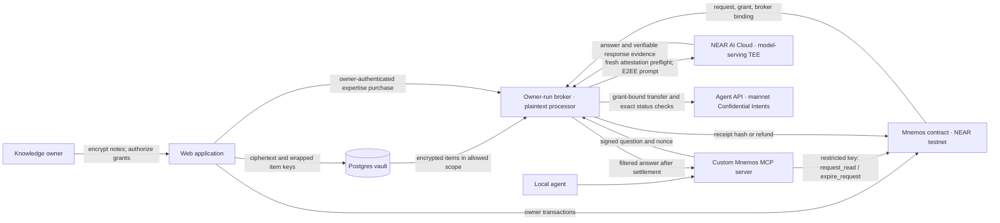

# NEAR integration: private knowledge, explicit authority, accountable payment

Mnemos turns an owner's encrypted notes into a scoped, metered answer service for
agents. NEAR supplies three distinct capabilities: a testnet contract that
authorizes and escrows reads, NEAR AI Cloud that supplies verified private
inference, and the Agent API that applies owner-signed wallet policy to a
separate mainnet USDC offer. Each integration enforces a different boundary.

The useful unit is an **authorized answer**: the agent receives an answer derived
from an allowed scope, while the owner retains control over the source vault,
grant, price, daily read cap and answer length. The contract records settlement
hashes instead of source notes or answer text. The owner-run broker still
processes plaintext; the model's attestation does not make the broker an enclave.

## Integration status

**Implemented** means the code path exists. **Live verified** means the recorded
evidence exercises the real external service. **Planned** means future work.
These labels are deliberately separate from test coverage.

| Capability | Status | Evidence and boundary |
| --- | --- | --- |
| Testnet NEAR grants, credit escrow, scoped reads, receipt settlement and refunds | Implemented; real testnet path exercised | [Contract](../contracts/mnemos/src/lib.rs), [CLI demo](../scripts/demo.py), [verification guide](VERIFICATION.md). The reproducible CLI and browser flows return settlement and inference evidence; see the current verification record. |
| Restricted agent access key | Implemented; live verified | The [evidence snapshot](JUDGING_EVIDENCE.json) records RPC permission checks for one contract, two methods and finite gas allowance. |
| NEAR AI Cloud encrypted inference and model evidence | Implemented; live verified | Snapshot records `Qwen/Qwen3.8-27B`, `e2ee: true`, fresh preflight, `provider_tee`, one matching model report, `UpToDate` TCB and verified GPU evidence. |
| Rejection of a quote under the wrong nonce | Implemented; live verified | A fresh quote verifies under its original binding and fails with `binding.nonce_mismatch` under another nonce. |
| Agent API wallet creation, policies and grants | Implemented; live verified | Actual official demo service reports **mainnet**; owner-signed EIP-712 setup and real destination, per-transfer limit and revoked-grant refusals are recorded. |
| Mainnet USDC sale, refund and interrupted-operation recovery | Implemented; tested with deterministic HTTP and real Postgres | **Not live verified.** Wallets are intentionally unfunded at the user's request. |
| USD-budget refusal | Configured probe; not live verified | The service returns `insufficient_balance` before evaluating the zero-budget policy. This is not budget-enforcement evidence. |
| 1Click deposit-address helper | Implemented | Calls the Agent API deposit route. A quote or address is not evidence of a funded cross-chain payment; the wallets have not been funded. |
| Multi-seller marketplace and stronger broker isolation | Planned | See the [next steps](#next-steps-and-acceptance-evidence); neither is represented as a present guarantee. |

The checked-in [machine-readable snapshot](JUDGING_EVIDENCE.json) includes its
actual verification timestamp. It is evidence of those checks at that time,
not a promise that every upstream service is currently available. The
[verification guide](VERIFICATION.md) describes how to produce fresh evidence.

## Architecture and trust boundaries



The broker can decrypt items whose data keys are wrapped to its key, select the
context, send prompts, inspect model output and submit settlement. It is a
trusted owner-operated component. Encryption protects stored vault envelopes
and the SDK's inference transport; it does not conceal plaintext from the broker.

The contract authenticates the owner's registered broker and settles the read's
financial state. It does **not** verify a TEE quote or prove that the broker ran
the model. Model attestation and chain settlement remain separate pieces of
evidence. Mnemos also relies on the Agent API's settlement status and does not
independently verify its transparency-log proof.

### Why a custom contract and Agent API both belong

The buyer owns the spending authority. The knowledge seller owns the permission
to use particular knowledge. A generic wallet policy can restrict actions,
assets, destinations and spend amounts; it cannot determine which seller's
notes may enter a model context or how many answer entitlements remain.

Mnemos therefore keeps knowledge scopes, seller grants, answer-token limits,
testnet credit escrow and hash-only read settlement in its contract. The
Agent API handles generic wallet policy and runtime spending grants for the
USDC offer. This avoids inventing a second general wallet-policy engine while
retaining the application's seller-specific authorization rules.

The rails are independent: a mainnet USDC purchase neither consumes testnet
NEAR credit nor increments a testnet grant counter or creates a testnet receipt.
The current offer is authorized by the configured knowledge owner's authenticated
session and permits only `expertise`. It is a laptop demonstration of one
configured offer, not an open marketplace where arbitrary sellers enroll.

## Testnet NEAR: grant → escrow → verified answer → receipt

```mermaid
sequenceDiagram
    actor Owner
    participant MCP as Agent / Mnemos MCP
    participant Chain as Testnet contract
    participant Broker as Owner-run broker
    participant AI as NEAR AI Cloud SDK
    Owner->>Chain: set_broker; create_grant(agent, scopes, price, cap, expiry, tokens)
    Note over MCP,Chain: Agent credit is deposited before runtime reads
    MCP->>Chain: request_read(owner, scope, q_hash)
    Chain->>Chain: Validate grant; reserve price and daily entitlement
    Chain-->>MCP: Approved request ID
    MCP->>Broker: Signed request ID, question, nonce and broker recipient
    Broker->>Chain: Check key, request, current grant and pause state
    Broker->>Broker: Claim ID; decrypt and rank allowed-scope items
    Broker->>AI: Fresh client; verify preflight; encrypted completion
    AI-->>Broker: Completion; verified provider_tee evidence
    Broker->>Broker: Check output; retry once if necessary
    alt Verified output passes filter
        Broker->>Chain: record_receipt(request ID, receipt hash)
        Chain->>Chain: Escrow becomes owner earnings
        Broker-->>MCP: Answer and settlement evidence
    else Inference, verification or output failure
        Broker->>Chain: refund(request ID, reason)
        Chain-->>MCP: Restore credit; release applicable daily slot
        Broker-->>MCP: Withheld answer or error with refund state
    end
```

The [contract implementation](../contracts/mnemos/src/lib.rs) supplies these
concrete controls:

- `create_grant` binds a knowledge owner to an agent, scopes, per-read price,
  daily cap, expiry and maximum answer tokens. Grant replacement and revocation
  are owner actions. Grant creation validates scope syntax, expiry and bounds.
- `deposit_credit` prepays NEAR into the agent's credit balance. Runtime
  `request_read` attaches no read-price deposit: it reserves credit already held
  by the contract and creates an `Approved` request.
- `request_read` rejects paused operation, missing/revoked/expired grants,
  disallowed scopes, exhausted daily cap, insufficient credit and too many
  pending reads. Its on-chain question commitment is
  `SHA-256(question || nonce)`, not the question text.
- `record_receipt` accepts only the owner's registered broker. It settles the
  reserved price into owner earnings, removes the outstanding request and
  appends a bounded recent receipt containing the receipt hash.
- Broker `refund` restores the request price to agent credit and releases the
  applicable daily counter slot. Anyone can call `expire_request` after the
  ten-minute request TTL to reclaim an unserved request's credit. Daily
  accounting uses block-timestamp day indices.
- Credit and earnings withdrawals use callbacks that restore balances when
  the outward transfer fails. Pausing blocks new grants/reads while existing
  settlement and recovery methods remain available.

The [broker pipeline](../apps/broker/src/mnemos_broker/pipeline.py) independently
checks the signing key against RPC, the question commitment, request owner/agent,
request age, live grant and pause state before loading memory. A database claim
prevents the same request ID from generating another answer. It returns an
answer only after receipt settlement succeeds; failure handling attempts a
refund and records unresolved refund state rather than claiming success.

### Least-authority runtime key

[Runtime provisioning](../apps/broker/src/mnemos_broker/near/runtime_key.py) creates
a separate testnet function-call key with a finite `0.05 NEAR` gas allowance,
restricted to **exactly** `request_read` and `expire_request` on the configured
Mnemos contract. That allowance funds transaction gas; it is not the knowledge
read budget. Read credit and daily cap are separate contract controls.

Transaction gas also has an upfront reservation requirement: a restricted key
can have a positive remaining allowance yet lack enough allowance for the gas
attached to the next call at the network's purchase price. Runtime gas settings
must fit that reservation as well as the method's actual execution cost. A
reservation failure occurs before knowledge authorization; it is not evidence
that the read scope or price was accepted.

The [permission validator](../apps/broker/src/mnemos_broker/near/access.py) and
[broker chain client](../apps/broker/src/mnemos_broker/chain.py) reject full-access
keys, wrong receiver contracts, unrestricted or mismatched method lists, and
missing, zero or exhausted allowances on agent reads. The runtime agent cannot
use that key to create grants, change the broker, withdraw funds or settle its
own answer. The separate recovery key is not repurposed as the runtime key.

The [custom MCP tools](../apps/mcp/src/tools.ts) expose `ask_memory`, `list_grants`
and `check_credit`. `ask_memory` makes the testnet read request, checks approval,
signs the broker-bound request and returns the answer plus attestation and
receipt/refund evidence. Its [chain adapter](../apps/mcp/src/chain.ts) performs
real NEAR RPC views and signed calls. This is Mnemos' own MCP server; it is not
the official NEAR MCP server.

## NEAR AI Cloud: verification before delivery

The [inference engine](../apps/broker/src/mnemos_broker/inference.py) uses the
official `nearai-inference-sdk==0.3.0`, pinned in
[broker dependencies](../apps/broker/pyproject.toml) and the
[lockfile](../apps/broker/uv.lock). The configured model in the live evidence is
`Qwen/Qwen3.8-27B`.

```python
client = InferenceClient(
    api_key,
    base_url=base_url,
    e2ee=True,
    attestation_cache_time_to_live_ms=0,
)
# One client per completion; closed after that completion.
completion = await client.chat.completions.create(...)
verified = await client.verify_response(completion.id)
if verified.signature_kind != "provider_tee" or len(verified.attestations) != 1:
    raise ValueError("a unique verified model-serving TEE signature is required")
```

The fresh client and zero cache lifetime prevent a prior completion's attestation
session from being reused. In the pinned SDK, `core/cloud_api.py` generates fresh
32-byte nonces for attestation requests, and `core/inference_client.py` verifies
gateway evidence and all returned model candidates before submitting the
encrypted prompt. Response verification retains the exact transport bytes and
binds the signature to preflight evidence. Mnemos then requires `provider_tee`
and exactly one matching verified model report before accepting the result.
There is no fallback to an unverified model response.

This follows the documented separation between
[fresh deployment verification](https://docs.near.ai/cloud/verification),
[model report selection](https://docs.near.ai/cloud/verification/cloud-api/model-attestations)
and [response signatures](https://docs.near.ai/cloud/verification/cloud-api/response-signatures).
A gateway-only signature is insufficient for Mnemos' policy. A report fetched
after the answer cannot replace verified preflight evidence.

The exported attestation summary includes the signer, algorithm, signature kind,
TCB/advisory information, deployment measurements, GPU evidence when present and
verification time. The current evidence says `deployment_provenance: not_checked`;
it does not establish an independently audited source-to-image provenance chain.

Two hash layers have different purposes:

| Evidence | Meaning |
| --- | --- |
| SDK response verification | Cryptographic verification over exact request/response transport bytes, matched to verified preflight model evidence. |
| Mnemos receipt hash | An application commitment over request ID, completion ID, canonical request/response projection hashes and signer address. Used for contract settlement and correlation. |

Mnemos labels its hash basis
`application-projections-not-sdk-wire-signature`. Re-serialized JSON projections
are not presented as the exact bytes used by the SDK's signature verifier.

After verification, the pipeline applies an output disclosure filter and may
retry once with a stricter prompt. If both answers fail, it withholds the answer
and attempts the refund. This reduces direct source reproduction; it cannot
prove that paraphrases or repeated questions disclose no sensitive information.
Revoking a grant also cannot erase an answer already delivered.

### Bounded answer generation

For the configured Qwen model, the completion uses the documented
`chat_template_kwargs.enable_thinking=false` option. This keeps the expert's
small output budget available for the final answer instead of consuming it in
hidden reasoning; it does not raise the token cap or relax verification.

## Agent API: owner-signed policy and a separate USDC purchase

The [setup script](../scripts/agent_api.py) uses the actual official Agent API
demo service, checks its network, obtains a service-generated intent, validates
the EIP-712 signing standard and owner identity, signs that exact typed payload,
submits it and waits for settlement. Owner actions create/update policies and
issue/revoke grants. Runtime receives the partner credential and grant tokens;
the setup owner's signing key is not passed to the broker.

The configured policy permits confidential USDC transfers to the designated
counterparty, with per-transfer and daily asset limits plus USD-budget settings.
The seller policy permits returns to the buyer. Policies express what may be
done; runtime grants identify who may act. This follows the official
[Agent API authority model](https://docs.agentsonintents.com/integration/agent-api/concepts).

```mermaid
sequenceDiagram
    actor Owner
    participant Broker
    participant DB as Postgres purchase record
    participant API as Agent API / Confidential Intents
    participant AI as Verified inference pipeline
    Owner->>Broker: Authenticated expertise offer; stable purchase UUID
    Broker->>DB: Bind UUID to owner, question, scope and terms; lock ID
    Broker->>API: transfer(USDC, 10000 atomic, seller, reference)
    API-->>Broker: Accepted operation ID
    Broker->>DB: Commit operation ID before polling
    Broker->>API: Poll exact operation status
    API-->>Broker: SUCCESS with transfer details and intent hash
    Broker->>Broker: Match buyer, type, asset, amount, recipient, reference, confidential flag
    Broker->>DB: Commit paid state
    Broker->>AI: Generate verified, filtered expertise answer
    alt Answer passes
        Broker->>DB: Commit served, answer hash and attestation
        Broker-->>Owner: Answer and payment evidence
    else Inference or verification fails
        Broker->>DB: Commit refund_pending
        Broker->>API: Seller transfer back to buyer; stable refund reference
        Broker->>DB: Checkpoint refund operation; confirm; commit refunded
    end
    Note over Owner,API: Implemented and fixture-tested; live wallets intentionally unfunded
```

The [Agent API client](../apps/broker/src/mnemos_broker/agent_api.py) restricts
credentials to official API hosts and disables redirects. An accepted operation
is not proof of payment. Before inference, `confirm` requires `SUCCESS`, the
expected correlation and agent IDs, transfer type/action, exact request fields
and a settlement intent hash. Confidential settlement may yield an intent hash
without a public mainnet transaction hash.

The [commerce service](../apps/broker/src/mnemos_broker/commerce.py) prices the
current offer at `10000` atomic USDC, or **0.01 USDC**, and rejects scopes other
than `expertise` before charging. A purchase UUID is bound to the authenticated
owner, question, scope and snapshotted terms. A Postgres advisory transaction
lock prevents concurrent execution of the same UUID. Stable external idempotency
references protect retries; accepted payment/refund operation IDs are committed
before status polling so recovery can inspect an existing operation after a
restart or grant revocation.

The durable path is `pending → paying → paid → served`, with
`paid → refund_pending → refunded` on failure. Once refund begins, the service
does not return to inference. The owner-only `/commerce/refund` endpoint takes
the purchase ID, enabling recovery after a reload without reconstructing the
original question. It never starts a new buyer payment. A completed purchase
cannot be charged again or replay its answer plaintext; the history retains
payment, answer-hash and attestation evidence rather than answer text.

### What the live mainnet checks establish

The [recorded refusals](JUDGING_EVIDENCE.json) come from actual transfer requests:

| Probe | Recorded service result | Claim supported |
| --- | --- | --- |
| Unapproved destination | `policy_destination_denied` | Destination restriction enforced for the probe. |
| Excessive per-transfer amount | `policy_transaction_limit_exceeded` | Per-transfer asset limit enforced for the probe. |
| Revoked runtime grant | `agent_grant_required` | Revoked grant could not authorize the transfer. |
| Zero USD-budget agent with no funds | `insufficient_balance` | Balance validation refused the transfer; USD-budget enforcement remains unverified. |

The buyer's recorded balance is zero. The user chose to leave the wallets
unfunded, so successful USDC payment, mainnet refund and funded budget refusal
remain unverified. The UI displays **Funding needed** and disables new purchases.
The [integration tests](../apps/broker/tests/test_api_commerce.py) exercise
successful and denied payments, exact evidence checking, concurrency, crashes,
refunds, operation recovery after revocation and refund by ID using deterministic
HTTP fixtures with real Postgres. Those tests are not mainnet payment evidence.

`make agent-api-fund` implements a separate 1Click deposit-address helper for
one Base USDC. It queries tokens, submits an Agent API deposit request and
prints the returned chain/address/expiry information. No funding is part of
the verification commands below. Creating funding instructions does not prove
that a cross-chain transfer was sent or settled.

## Source map

| Integration seam | Source |
| --- | --- |
| Grants, credit escrow, settlement, refunds, expiry and withdrawal callbacks | [Contract](../contracts/mnemos/src/lib.rs), [bounds and data types](../contracts/mnemos/src/types.rs) |
| Restricted runtime key and RPC permission enforcement | [Provisioning](../apps/broker/src/mnemos_broker/near/runtime_key.py), [permission predicate](../apps/broker/src/mnemos_broker/near/access.py), [chain adapter](../apps/broker/src/mnemos_broker/chain.py) |
| Agent tool interface and signed testnet requests | [MCP tools](../apps/mcp/src/tools.ts), [MCP chain adapter](../apps/mcp/src/chain.ts), [signer](../apps/mcp/src/signer.ts) |
| Scope loading, output filtering, receipt commitment and refund handling | [Broker pipeline](../apps/broker/src/mnemos_broker/pipeline.py) |
| Fresh SDK session, encrypted inference and response verification | [Inference engine](../apps/broker/src/mnemos_broker/inference.py), [verification policy tests](../apps/broker/tests/test_inference_policy.py) |
| Agent API owner signing, grants, refusal probes and funding helper | [Setup/check script](../scripts/agent_api.py) |
| Exact payment status checks and durable purchase/refund flow | [Agent API client](../apps/broker/src/mnemos_broker/agent_api.py), [commerce service](../apps/broker/src/mnemos_broker/commerce.py), [owner endpoints](../apps/broker/src/mnemos_broker/api/commerce.py) |
| Real-service evidence generation | [Judging runner](../scripts/judging-check.py), [inference probe](../scripts/verify-nearai.py), [negative nonce probe](../scripts/verify-attestation-negative.py) |
| Reviewable snapshot and reproduction notes | [Evidence JSON](JUDGING_EVIDENCE.json), [verification guide](VERIFICATION.md) |

## Reproduce and inspect

Run from the repository root on the configured laptop. Local credentials and
funded testnet accounts are prerequisites; keep secret values out of terminal
output and recordings. Setup commands provision local runtime configuration
and real Agent API identities/policies. Testnet demos spend testnet NEAR and
NEAR AI Cloud credits. They do not fund or purchase on mainnet.

```bash
make install
make demo-ready
make agent-api-setup
docker compose up -d --build --wait
```

Run each group sequentially; CLI and browser demos mutate the same sample grant.

| Command | Expected assertions / review target |
| --- | --- |
| `make doctor` | Services respond; deployed testnet bindings and the agent's restricted RPC key permission match configuration. |
| `make check` | Contract formatting/lints/unit tests, crypto/vector checks, broker static checks/unit tests, MCP and web checks pass without live model calls or chain writes. |
| `make test-e2e` | Contract sandbox tests, broker integration tests against real Postgres and Playwright complete. This includes fixture-backed commerce cases; it does not establish funded mainnet payment. |
| `make agent-api-check` | Actual destination, per-transfer and revoked-grant probes return the expected refusals. Unfunded USD-budget probe is explicitly reported as not exercised. |
| `make judging-check` | Fresh inference records `provider_tee`, unique report and fresh preflight; valid quote verifies; altered nonce fails; RPC key and Agent API policy checks are recorded. Mainnet sale/refund remains false. |
| `make demo` | Real testnet request, signed broker call, verified answer and receipt/refund behavior are exercised. Inspect actual transaction evidence and refusal cases in the run output. |
| `make record-demo` | Replays the browser demonstration and writes local artifacts under `artifacts/demo`; inspect the new run before treating it as a completed recording. |

`make judging-check` writes [JUDGING_EVIDENCE.json](JUDGING_EVIDENCE.json) and
local diagnostic artifacts. Inspect its explicit fields rather than interpreting
an overall runner exit as evidence for unfunded paths:

```bash
python - <<'PY'
import json
from pathlib import Path

e = json.loads(Path("docs/JUDGING_EVIDENCE.json").read_text())
a = e["model"]["attestation"]
assert e["model"]["e2ee"] is True
assert a["fresh_preflight"] is True
assert a["signature_kind"] == "provider_tee"
assert a["model_attestations"] == 1
assert e["nonce_negative_test"]["valid_quote_verified"] is True
assert e["nonce_negative_test"]["tampered_nonce_rejected"] is True
assert e["agent_api"]["network"] == "mainnet"
for name in ("destination", "per-transaction limit", "revoked grant"):
    assert next(c for c in e["agent_api"]["checks"] if c["name"] == name)["passed"]
assert e["mainnet_purchase_live_verified"] is False
print("Recorded evidence has the documented integration boundaries.")
PY
```

These assertions inspect the saved snapshot; only the live commands refresh it.
If RPC or an upstream verification call fails, retain the failure and rerun after
resolving it. A failed or incomplete run does not become a successful recording
or payment merely because an earlier snapshot exists.

## Next steps and acceptance evidence

| Planned work | Evidence required before expanding the claim |
| --- | --- |
| Funded USDC commerce validation | A separately authorized funded run showing the exact successful transfer, delivered verified answer, failed-inference refund, and recovery by operation/purchase ID. |
| USD-budget enforcement validation | A funded probe that reaches budget evaluation and returns the documented budget refusal; an insufficient-balance result does not qualify. |
| Multiple independent sellers | Seller enrollment, seller-specific authentication and settlement terms, isolation tests and evidence that one owner's wallet/session cannot authorize another owner's offer. |
| Stronger broker deployment assurance | A concrete isolated broker deployment, key-release policy and independently checkable measurements/provenance. Model attestation alone cannot supply this. |
| Production operation | Independent contract/security review, recovery drills, monitoring and a documented operational model appropriate to real customer funds and sensitive knowledge. |

The present integration demonstrates an auditable division of authority:
seller-controlled knowledge permission, agent keys with limited on-chain power,
fresh verified private inference, and explicit payment/recovery state. It makes
no claim of Chain Signatures, official NEAR MCP integration, Agent Market hiring,
PingPay/x402, user adoption, production audit or guaranteed information secrecy.
